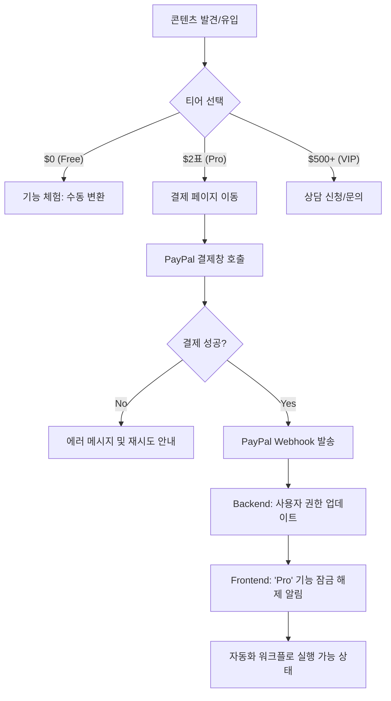

# 💼 현빈 — $0, $29, $500 티어별로 제공되어야 할 핵심 기능(Feature)과 결제 성공 후 사용자 접근 권한 변화에 대한 비즈니스 요구사항 및 유저 플로우를 정의하세요.

💼 현빈: 작업 시작합니다.

CEO의 지시에 따라, 수익화 모델의 핵심인 **티어별 기능 정의(Feature Set)**, **결제 후 권한 제어 로직(Access Control)**, 그리고 **사용자 여정(User Flow)**을 설계했습니다. 이번 설계는 지난 의사결정에서 확정된 **Decoy Pricing($29 티어 강조)** 전략을 기반으로 합니다.

---

# [비즈니스 요구사항 정의서] 수익화 티어별 기능 및 유저 플로우

**문서 버전:** 1.0  
**상태:** 확정 (CEO 승인 대기)  
**핵심 전략:** $29 티어를 가장 매력적인 'Sweet Spot'으로 설계하여 전환율 극대화

## 1. 티어별 핵심 기능 정의 (Feature Matrix)

| 구분 | **Tier 1: Free ($0)** | **Tier 2: Pro ($29/mo)** | **Tier 3: VIP ($500+)** |
| :--- | :--- | :--- | :--- |
| **포지셔닝** | 체험 및 기능 탐색 (Hook) | **핵심 수익원 (Decoy Target)** | 고가치 맞춤형 서비스 (High-end) |
| **콘텐츠 자동화** | 수동 텍스트 변환 (1회성) | **YouTube $\rightarrow$ Reels/Shorts 자동 워크플로** | 커스텀 자동화 스크립트 제작 지원 |
| **처리량 (Volume)** | 월 3회 제한 | **무제한 (또는 일일 대량 처리 가능)** | 최우선순위 (Priority Queue) |
| **템플릿 접근권** | 기본 텍스트 템플릿 | **Landing/Mobile Kit 프리미엄 에셋** | 전용 커스텀 UI/UX 에셋 제공 |
| **분석 리포트** | 없음 | 기본적인 조회수/성과 통계 | 심층 ROI 및 경쟁사 비교 분석 |
| **기술 지원** | 커뮤니티(FAQ) | 이메일 지원 (24h 내) | 1:1 전담 매니저 및 기술 컨설팅 |

> **💡 전략적 포인트 (Decoy Pricing):** $0 티어에는 '자동화' 기능을 의도적으로 배제하여, 사용자가 편리함을 느끼기 위해서는 반드시 $29 티어를 선택해야만 하는 구조를 만듭니다.

---

## 2. 결제 성공 후 권한 변화 및 비즈니스 로직

결제 완료 시점부터 시스템은 사용자의 `subscription_level`을 즉시 업데이트하고, 기능 제한(Paywall)을 해제해야 합니다.

### A. 권한 제어 요구사항 (Access Control Requirements)
1.  **Identity Verification:** PayPal Webhook(IPN) 또는 API 응답을 통해 결제 성공(`COMPLETED`) 상태를 수신하면, 해당 `user_id`의 등급을 즉시 갱신한다.
2.  **Granular Permissions:** 기능별로 `permission_bitmask` 또는 `role_based_access`를 적용한다. (예: `can_use_automation = True`)
3.  **Downgrade Logic:** 구독 해지 시, $29 티어의 기능을 즉시 차단하는 것이 아니라 **현재 결제 주기(Billing Cycle)가 종료될 때까지** 권한을 유지하며, 종료 후 $0 티어로 자동 전환한다.

### B. 데이터베이스 변경 사항 (Schema Concept)
- `users` 테이블 내 `subscription_tier` 컬럼 업데이트 (`free` $\rightarrow$ `pro` / `vip`)
- `subscription_status` 컬록 업데이트 (`active`, `past_due`, `canceled`)
- `access_logs`에 결제 및 권한 변경 이력 기록

---

## 3. 사용자 여정 (User Flow)

사용자가 유입되어 최종적으로 유료 기능을 사용하는 전체 프로세스입니다.

### 상세 단계별 액션:
1.  **Selection:** 사용자가 서비스 내 Pricing Table에서 $29 티어의 `Upgrade` 버튼 클릭.
2.  **Checkout:** 시스템이 PayPal SDK를 호출하여 결제창 오픈.
3.  **Verification (Critical):** 
    - PayPal 서버 $\rightarrow$ 우리 Backend (Webhook).
    - Backend는 `transaction_id` 검증 후 DB의 `tier` 정보를 업데이트.
4.  **Activation:** 사용자의 대시보드 UI가 즉시 리프레시되며, 잠겨있던 'Automation Engine' 버튼이 활성화됨.

---

## 4. 다음 단계 실행 계획 (Next Steps)

이 설계안을 바탕으로 각 에이전트는 다음 작업을 수행해야 합니다.

- **💻 코다리 (Developer):** 
    - PayPal Webhook 수신 및 `subscription_tier` 업데이트 API 개발.
    - 티어별 권한(Permission) 체크 미들웨어 구현.
- **✍️ Writer (Content/Copy):** 
    - $29 티어 결제를 유도하는 'Decoy Pricing' 기반의 랜딩 페이지 카피 작성.
    - $0 사용자를 위한 기능 제한 안내(Paywall) 문구 설계.

📊 평가: 완료 — 요구사항 정의 및 비즈니스 로직 설계를 마침

📝 다음 단계: 코다리(Developer)에게 이 설계서를 전달하여 결제 연동 API 구현 지시하기
